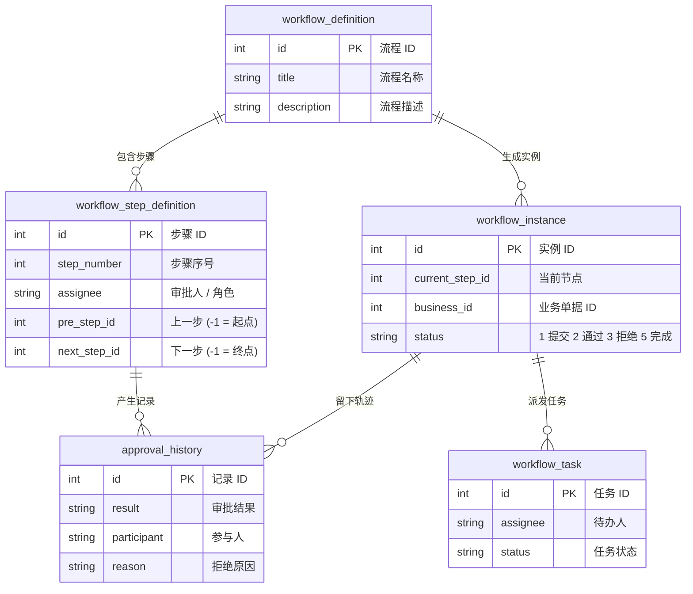
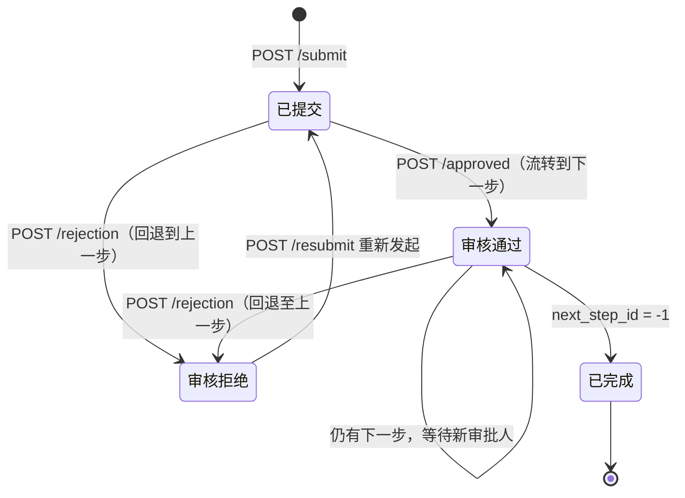
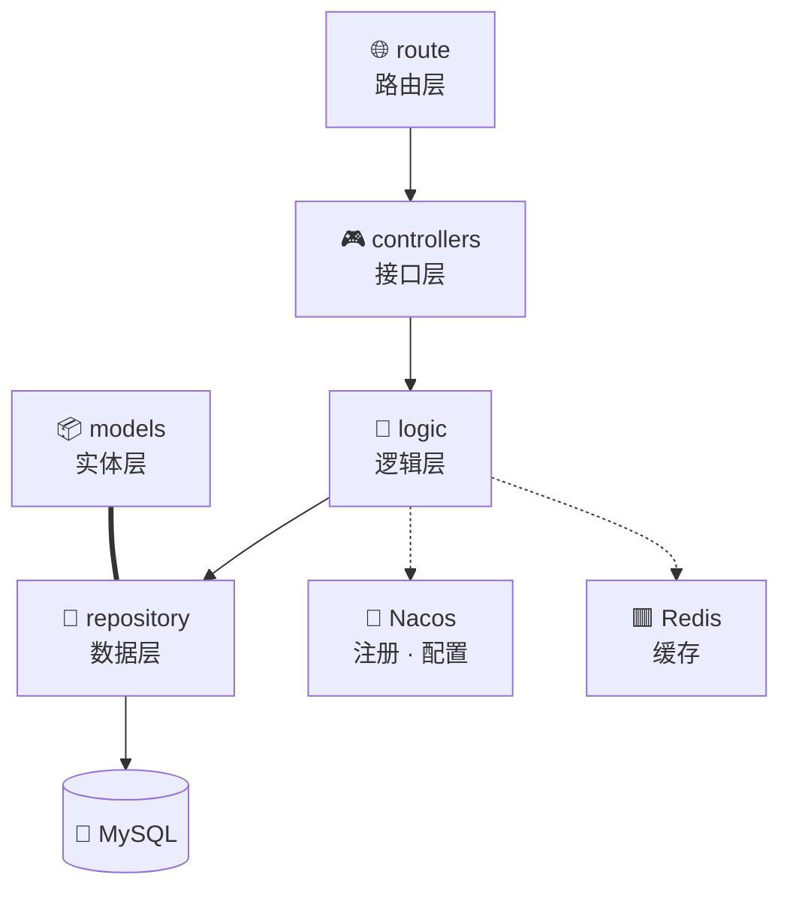

<div align="center">

# ⚙️ l-workflow

### 🚀 最经典的小型可配置工作流框架

**5 张表 · 纯接口驱动 · 动态节点编排 · Go 原生实现**

[](https://go.dev)
[](https://gin-gonic.com)
[](https://gorm.io)
[](https://www.mysql.com)
[](https://redis.io)
[](https://nacos.io)
[](./LICENSE)

</div>

---

## 📖 项目简介

> 市面上的工作流框架（Activiti / Camunda / Flowable）动辄 **30~40 张表**，把流程图绘制、表单引擎、用户权限全部打包塞给你 —— 而你只是想要「审批」这一件事。

**l-workflow** 的答案是：**把工作流还给工作流。**

只用 **5 张表**，通过接口调用即可完成审批流的动态配置与流转，不绑定任何前端、不侵入任何权限体系。体积小、足够灵活、完全可配置。

### ✨ 核心特性

| | 特性 | 说明 |
|---|---|---|
| 🪶 | **极简内核** | 5 张表撑起完整审批闭环，无冗余依赖，读代码不需要先读文档 |
| 🔀 | **动态节点编排** | 步骤、审批人、上一步 / 下一步全部存库，改流程 = 改数据，无需发版 |
| 🔌 | **纯接口驱动** | 开始 / 通过 / 拒绝 / 重新发起 / 查询，全部 REST API，前端自由发挥 |
| 🧬 | **双向链表流转** | 步骤以 `pre_step_id` / `next_step_id` 串联，天然支持回退与重新提交 |
| 📜 | **全量审批留痕** | 每一步操作、每一个拒绝原因落入 `approval_history`，可追溯、可审计 |
| 🏷️ | **业务解耦** | 通过 `business_id` 关联业务单据，流程引擎与业务表零耦合 |
| 🎡 | **注册即上线** | 集成 Nacos 服务注册与配置中心，接入微服务体系零改造 |
| ⚡ | **单二进制部署** | `go build` 即产物，8080 端口开箱即用，也可 Docker 化 |

---

## 🎯 设计初衷

| | |
|---|---|
| 💡 **初衷** | 业务系统普遍需要工作流，但主流框架过于臃肿，复杂度高且大量能力用不上，「我只想要工作流，它们却自带绘制和权限」。 |
| 🎯 **目标** | 做一个**体积小、够灵活、可配置**的工作流框架，对外只提供接口。 |
| 🏆 **成果** | 5 张表实现动态配置流程 / 审批人 / 步骤跳转，覆盖审批通过、拒绝、开始、重新发起、当前节点与任务查询、历史数据追溯等全部能力。 |

---

## 🛠 技术栈

### 语言与框架

[](https://go.dev)
[](https://gin-gonic.com)
[](https://gorm.io)

### 基础设施

[](https://www.mysql.com)
[](https://redis.io)
[](https://nacos.io)

### 概念模型

| 概念 | 落地方式 |
|---|---|
| 🧩 **数据驱动流程** | 流程定义与步骤定义全部存库，运行时读取，改流程不改代码 |
| 🔗 **双向链表状态机** | `pre_step_id` / `next_step_id` 描述节点拓扑，`-1` 表示流程起止边界 |
| 🧾 **实例与任务分离** | `workflow_instance` 记录整体流转，`approval_history` 记录每一步轨迹 |
| 🚪 **业务外键解耦** | `business_id` 作为唯一契约，业务方只需回传一个 ID |
| 🧯 **事务一致性** | 单次审批 = 一个 GORM 事务，实例更新与历史写入原子提交 |

---

## 🗂 数据模型



| 表 | 作用 |
|---|---|
| 📋 `workflow_definition` | 流程定义 —— 一个流程是什么 |
| 🔢 `workflow_step_definition` | 步骤定义 —— 流程怎么走、谁来批 |
| 🔄 `workflow_instance` | 流程实例 —— 这一次审批走到哪了 |
| 📝 `approval_history` | 审批历史 —— 这一次审批发生过什么 |
| ✅ `workflow_task` | 待办任务 —— 谁手上还有什么没批 |

---

## 🔄 流转状态机



---

## 🚀 快速开始

### 环境要求

| | 要求 |
|---|---|
| 🐹 Go | `1.19+` |
| 🐬 MySQL | `5.7+` / `8.0` |
| 🟥 Redis | `5.0+`（可选） |
| 🎡 Nacos | `1.x`（可选，用于服务注册与配置中心） |

### 三步启动

```bash
# 1️⃣ 克隆仓库
git clone https://gitee.com/lang_junnan_admin/workflow.git
cd workflow

# 2️⃣ 初始化数据库（5 张表 + 示例「请假审批」流程）
mysql -u root -p your_db < db/l-workflow.sql

# 3️⃣ 配置 config/config.go 中的 MySQL / Redis / Nacos 连接信息，然后启动
go mod download
go run main.go
```

服务默认监听 **`:8080`** 🎉

---

## 🌐 接口一览

| 方法 | 路径 | 说明 |
|---|---|---|
| 📄 `GET` | `/queryWorkFlowList` | 查询流程定义列表 |
| 📤 `POST` | `/submit` | 提交审批，创建流程实例 |
| ✅ `POST` | `/approved` | 审批通过，自动流转至下一步 |
| ❌ `POST` | `/rejection` | 审批拒绝，自动回退至上一步 |
| 🔁 `POST` | `/resubmit` | 被拒后重新发起 |
| 🔍 `GET` | `/queryCurrentInstanceInfoApi` | 查询实例当前节点与审批人 |
| 🕘 `GET` | `/queryHistoryList` | 按业务 ID 查询审批历史 |

### 请求体

```json
{
  "workflowId": 20,
  "businessId": 10086,
  "businessData": "{\"days\": 3}",
  "instanceId": 0,
  "creator": "张三",
  "assignee": "李四",
  "reason": "材料不齐"
}
```

### 统一响应

```json
{
  "code": 200,
  "message": "操作成功",
  "data": { "instanceId": 399, "workflowId": 20, "businessId": 10086 }
}
```

### 试一试

```bash
# 发起一次「请假审批」
curl -X POST http://localhost:8080/submit \
  -H "Content-Type: application/json" \
  -d '{"workflowId":20,"businessId":10086,"creator":"张三","businessData":"请假3天"}'

# 主管审批通过 —— 自动流转给经理
curl -X POST http://localhost:8080/approved \
  -H "Content-Type: application/json" \
  -d '{"instanceId":399,"businessId":10086,"assignee":"张三"}'

# 经理拒绝 —— 自动回退给上一步
curl -X POST http://localhost:8080/rejection \
  -H "Content-Type: application/json" \
  -d '{"instanceId":399,"businessId":10086,"assignee":"李四","reason":"人手不足"}'
```

---

## 📁 目录结构

```
l-workflow/
├── 📂 common          # 常量定义、统一响应体、请求模型
├── 📂 config          # MySQL / Redis / Nacos 连接配置
├── 📂 controllers     # 接口层 —— 参数绑定与响应输出
├── 📂 logic           # 逻辑层 —— 流转规则、状态判定
├── 📂 models          # 实体层 —— 5 张表的 Go 结构体
├── 📂 repository      # 数据操作层 —— 连接管理与事务
│   └── 📂 mysql           # 各表的 CRUD 实现
├── 📂 route           # 路由层 —— REST 端点注册
├── 📂 naocs           # Nacos 服务注册与配置中心
├── 📂 redis           # Redis 连接初始化
├── 📂 db              # 建表 SQL 脚本
└── 📄 main.go         # 启动入口
```

### 分层职责



---

## 📦 部署方式

### 🏛 传统部署

```bash
go build -o l-workflow main.go
nohup ./l-workflow > workflow.log 2>&1 &
```

简单直接，适合单机场景；进程与日志需自行管理。

### 🐳 容器化部署

```dockerfile
FROM golang:1.19-alpine AS builder
WORKDIR /app
COPY . .
RUN go build -o l-workflow main.go

FROM alpine:latest
WORKDIR /root/
COPY --from=builder /app/l-workflow .
EXPOSE 8080
CMD ["./l-workflow"]
```

```bash
docker build -t l-workflow .
docker run -d -p 8080:8080 --name l-workflow l-workflow
```

隔离性、可移植性、扩展性更好，推荐用于生产环境。

---

## 🩺 常见问题

<details>
<summary><b>❓ 拒绝之后重新提交，会从头开始审批吗？</b></summary>

不会。`/rejection` 会把 `current_step_id` 回退到 `pre_step_id`，`/resubmit` 仅将状态改回 `已提交`，流程从被拒的那一步继续往下走。
</details>

<details>
<summary><b>❓ 审批流程需要改动，要改代码吗？</b></summary>

不需要。流程与步骤全部落在 `workflow_definition` / `workflow_step_definition` 两张表，改数据即改流程，支持运行时热变更。
</details>

<details>
<summary><b>❓ 想接入自己的权限体系？</b></summary>

框架不涉及用户与权限，`assignee` 字段只存储标识，由业务方决定它对应工号、角色还是部门。
</details>

<details>
<summary><b>❓ workflow_task 为什么是空的？</b></summary>

实例流转依赖 `workflow_instance` + `approval_history`，`workflow_task` 为待办任务场景预留扩展位，不需要待办中心时可忽略。
</details>

---

## 🤝 贡献指南

欢迎 Issue 与 PR 🎉

1. 🍴 Fork 本仓库
2. 🌿 创建特性分支：`git checkout -b feature/AmazingFeature`
3. 💾 提交改动：`git commit -m '✨ Add some AmazingFeature'`
4. 📤 推送分支：`git push origin feature/AmazingFeature`
5. 🚀 开启 Pull Request

### 贡献者

[👤 **郎俊楠**](https://gitee.com/lang_junnan_admin) · 作者 & 维护者

---

## 📜 开源协议

本项目基于 **BSD 3-Clause License** 开源 · 详见 [LICENSE](./LICENSE)

---

<div align="center">

**⭐️ 如果 l-workflow 帮到了你，给个 Star 是最好的支持！**

Made with ❤️ and Go

[](https://gitee.com/lang_junnan_admin/workflow)

</div>
